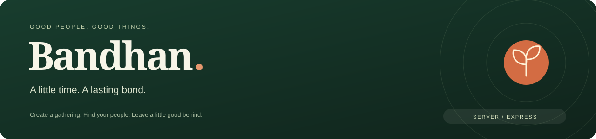
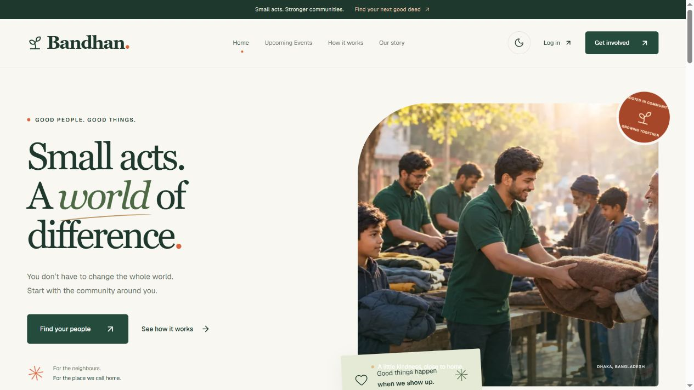
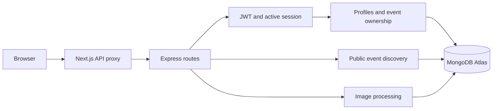

<div align="center">
  
  <p><strong>The API behind local gatherings, trusted accounts and shared purpose.</strong></p>
  <p>
    <a href="https://social-events-client-cyan.vercel.app"></a>
    <a href="https://social-events-server-yvf5.onrender.com/api/ready"></a>
  </p>
  <p>
    
    
    
    
    
    
  </p>
  <p><a href="#what-the-api-handles">Features</a> · <a href="#run-it-locally">Setup</a> · <a href="#api-reference">API reference</a> · <a href="#verification">Verification</a> · <a href="#assignment-submission">Submission links</a></p>
</div>

## 🌿 Behind the community

Bandhan helps neighbours create, join and track social service events. This repository provides authentication, event discovery, owner-only management, participation, photo storage and editable profiles.

| Destination | Link |
|---|---|
| Live website | [social-events-client-cyan.vercel.app](https://social-events-client-cyan.vercel.app) |
| API health | [Server status](https://social-events-server-yvf5.onrender.com/api/health) |
| Database readiness | [Server and MongoDB status](https://social-events-server-yvf5.onrender.com/api/ready) |
| Frontend source | [Social-Events-Client](https://github.com/rafidhasansydney/Social-Events-Client) |

## 📸 The experience this API powers



A real screenshot of the client connected to this API. [Explore frontend screenshots](https://github.com/rafidhasansydney/Social-Events-Client#a-look-around) for light, dark and mobile views.

<a name="what-the-api-handles"></a>

## ✨ What the API handles

- **Member authentication:** BetterAuth email/password sessions, Google Login, JWT issuance and public JWKS.
- **Protected access:** JWT signature, expiry, issuer and audience checks, followed by active-session verification. Logout revokes protected access.
- **Event discovery:** Future events in date order, MongoDB `.limit()`, cause filtering and literal title/location search.
- **Owner management:** Verified organisers create and edit their events. Other users cannot change or delete them.
- **Participation:** One saved join per member/event. Organisers cannot join their own gatherings; past events do not accept joins.
- **Consistent deletion:** Transactions remove an event and its participation records together. Joining and deletion coordinate to avoid orphan records.
- **Photo uploads:** Authenticated JPG, PNG and WebP uploads are decoded, resized and stored as WebP in MongoDB.
- **Editable profiles:** Name, photo, area and bio validation, with identity and email protected from profile overwrites.
- **Useful failures:** Structured errors, restricted CORS, image limits and separate health/readiness endpoints.

## 🧩 Request journey



Browser requests and the live Google callback pass through the frontend `/api/*` proxy, so the session cookie belongs to the website origin.

<a name="run-it-locally"></a>

## 🚀 Run it locally

Use Node.js 24 and npm, plus a MongoDB deployment that supports transactions, such as Atlas. In Git Bash:

```bash
git clone https://github.com/rafidhasansydney/Social-Events-Server.git
cd Social-Events-Server
npm ci
cp .env.example .env
```

Fill in `.env`, then run `npm run dev`. The local API listens on [localhost:5000](http://localhost:5000/api/health). Startup requires a working database connection and permission to initialise collections and indexes.

| Variable | Local value or requirement |
|---|---|
| `PORT` | `5000` |
| `MONGODB_URI` | Your Atlas connection string |
| `MONGODB_DB_NAME` | `bandhan` |
| `CLIENT_URL` | `http://localhost:3000` |
| `BETTER_AUTH_URL` | `http://localhost:5000` |
| `BETTER_AUTH_SECRET` | A stable random secret of at least 32 characters |
| `GOOGLE_CLIENT_ID` | Google OAuth web client ID |
| `GOOGLE_CLIENT_SECRET` | Google OAuth client secret |

`.env` is gitignored. Store hosting credentials in environment settings. Use `npm start` to run the server without development file watching.

<a name="api-reference"></a>

## 📡 API reference

Protected requests require a bearer JWT and its active session cookie.

| Area | Routes | Access |
|---|---|---|
| Service status | `GET /api/health`, `GET /api/ready` | Public |
| Authentication | `/api/auth/*` | Varies by BetterAuth endpoint |
| Discovery | `GET /api/events`, `GET /api/events/:id` | Public |
| Create | `POST /api/events` | Member |
| Personal lists | `GET /api/events/mine`, `GET /api/events/joined` | Member |
| Manage | `GET /api/events/:id/manage`, `PUT /api/events/:id`, `DELETE /api/events/:id` | Owner |
| Participation | `GET /api/events/:id/participation`, `POST /api/events/:id/join` | Member |
| Profile | `GET /api/me`, `PATCH /api/me` | Member |
| Photos | `POST /api/uploads?kind=event`, `POST /api/uploads?kind=profile` | Member |
| Image delivery | `GET /api/images/:id` | Public |

Example: `/api/events?limit=6&type=Cleanup&q=Dhaka`. `limit` accepts 1–100. The six supported causes are Cleanup, Plantation, Donation, Education, Health and Food Drive.

Read the [complete API and data reference](docs/API.md) for request fields, validation, response behaviour, transactions and upload limits.

## ☁️ Hosting and OAuth

| Render setting | Value |
|---|---|
| Runtime / Node | Node / `24.19.0` |
| Branch / root | `main` / repository root |
| Build / start | `npm ci` / `npm start` |
| `PORT` / `NODE_ENV` | `10000` / `production` |
| Health check | `/api/ready` |
| `CLIENT_URL` | `https://social-events-client-cyan.vercel.app` |
| `BETTER_AUTH_URL` | `https://social-events-client-cyan.vercel.app` |

Vercel sets `API_URL=https://social-events-server-yvf5.onrender.com`.

| Google OAuth setting | Local | Live |
|---|---|---|
| JavaScript origin | `http://localhost:3000` | `https://social-events-client-cyan.vercel.app` |
| Redirect URI | `http://localhost:5000/api/auth/callback/google` | `https://social-events-client-cyan.vercel.app/api/auth/callback/google` |

Only the basic identity scopes `openid`, `email` and `profile` are requested. Google's [audience guidance](https://support.google.com/cloud/answer/15549945?hl=en) explains their Testing-mode exception. Email verification and password reset are omitted for the assignment.

Atlas must allow the service's outbound ranges. This Render service reported `74.220.48.0/24` and `74.220.56.0/24`; recheck Connect → Outbound if it moves or is recreated. The free service can sleep while idle. Photos persist in MongoDB rather than the hosting filesystem.

<a name="verification"></a>

## ✅ Verification

| Command | What it checks |
|---|---|
| `npm test` | 32 tests for configuration, validation, JWT/session access, routes, errors, uploads and CORS |
| `npm run db:check` | DNS, certificate-verified TLS, MongoDB authentication and ping; no writes |
| `npm run auth:check` | Isolated account/profile/photo/event workflows using a temporary database |

The isolated check covers two-account ownership, duplicate joins, edit validation, ordering, transactional deletion and a concurrent join/delete race. It cleans up only its uniquely named test database and does not complete real Google consent.

On **5 November 2026**, all 32 unit tests and nine public production API checks passed. The isolated check could not be rerun from the local connection because Atlas TLS access failed before authentication. Production database readiness passed. The [current review report](https://github.com/rafidhasansydney/Social-Events-Client/blob/main/docs/VERIFICATION.md) records the tested scope.

## 📁 Project map

```text
src/config/       Environment, database and BetterAuth setup
src/routes/       Event and image routes
src/models/       Events, participation and uploaded-image storage
src/middleware/   Authentication and structured errors
src/utils/        Input validation and HTTP errors
src/scripts/      Database and isolated workflow checks
test/             Automated tests
docs/             API reference and README visuals
```

Profile routes are registered in `src/app.js`.

<a name="assignment-submission"></a>

## 📎 Assignment submission

| Required item | Link |
|---|---|
| Live site | [Bandhan](https://social-events-client-cyan.vercel.app) |
| Client repository | [Social-Events-Client](https://github.com/rafidhasansydney/Social-Events-Client) |
| Server repository | [Social-Events-Server](https://github.com/rafidhasansydney/Social-Events-Server) |

Built by [Rafid Hasan Sydney](https://github.com/rafidhasansydney).
